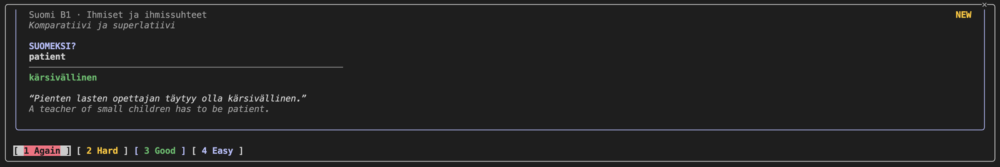

# tauko

**Learn something in the 30 seconds while Claude Code works, instead of scrolling.**

When you send Claude a prompt, a flashcard opens beside the chat. Answer a card or two, and when
Claude finishes, tauko tells you to go back. Spaced repetition decides what you see, so
those small gaps add up to real retention.



*tauko* is Finnish for "a pause".

## Install

```sh
curl -fsSL https://raw.githubusercontent.com/ralihachev/tauko/main/install.sh | sh
```

That's all. The script:
1. Downloads one binary for macOS or Linux and verifies it.
2. Puts it in `~/.local/bin` (no sudo).
3. Installs the Claude Code plugin.

Start a new Claude Code session and send a prompt.

<details>
<summary>Other ways to install</summary>

```sh
go install github.com/ralihachev/tauko/cmd/tauko@latest && tauko setup   # Go 1.26+
```

Or from source: `git clone https://github.com/ralihachev/tauko && cd tauko && make install && tauko setup`.
</details>

## Use

**In Claude Code**, cards come to you:

| Key | Does |
|---|---|
| type + `enter` | check your answer (typos and missing ä/ö count as "almost") |
| `enter` or `1`–`4` | grade it: Again, Hard, Good, Easy |
| `m` | switch between typing and tap-to-reveal |
| `Esc` | back to the prompt |
| `ctrl+x tab` | back to the card |
| `/tauko` | open the pane by hand |

**Pane placement:** in Claude Code's fullscreen mode (`/config`, or `"tui": "fullscreen"`), the pane
docks beside the chat. Otherwise it sits above the prompt. The status line shows what's left
(`📖 14 to do · 6 today · 🔥3`).

**Anywhere else:**

```sh
tauko                     # learn in the terminal
tauko quiz -unit b1-03    # 10-question self-quiz, scored
tauko units               # courses and progress
```


**In the browser:** open http://127.0.0.1:8787. It shows "Claude is working" and "Claude is done"
too. Keys: `space` reveal, `1`–`4` grade.

**On your phone:** the server only listens on your machine unless you give it a token:

```sh
TAUKO_TOKEN=$(openssl rand -hex 16) tauko serve -addr 0.0.0.0:8787
```

Then open `http://<your-computer>:8787/?token=<token>` on the phone (over [Tailscale](https://tailscale.com),
for example) and **Add to Home Screen**. Put it where Instagram used to be.

<br clear="right">

## Courses

tauko ships with **Finnish B1**: 8 units and 504 cards. They follow the topics and grammar of the
*Suomen mestari 3* textbook, with original content. tauko itself isn't tied to a language: a
course is a folder of JSON, and anything with questions and answers works (a language, a
certification, your team's codebase). See [docs/COURSES.md](docs/COURSES.md) to write one.
Pull requests with new courses are welcome.

## How it works

- **One small server** (`tauko serve`) on `127.0.0.1:8787` keeps your progress in SQLite under `~/.tauko`.
  The Claude Code plugin starts it for you.
- **FSRS scheduling** shows each card just before you'd forget it: due cards first, then 20 new ones a day.
- **Clients:** the Claude Code pane, the terminal, and the browser/phone app all use the same
  server, so progress is shared.
- **Privacy:** nothing leaves your machine. No account, no telemetry.

More in [docs/DESIGN.md](docs/DESIGN.md), including the roadmap: a course generator, quizzes about
the code your agent just wrote, and team leagues.

## Troubleshooting

```sh
tauko doctor        # checks the binary, server and plugin, and says how to fix each
```

- **No pane appears:** run `/reload-plugins` in Claude Code, or start a new session.
- **Typing goes to the prompt instead of the card:** press `ctrl+x tab`.
- **Server log:** `~/.tauko/serve.log`

## Uninstall

```sh
tauko uninstall          # removes the plugin and stops the server; keeps your progress
tauko uninstall -purge   # also deletes ~/.tauko
```

## Contributing

Courses, bug reports and code are all welcome. See [CONTRIBUTING.md](CONTRIBUTING.md).

## License

The code is [Apache-2.0](LICENSE). Course content is [CC BY-SA 4.0](content/LICENSE).
