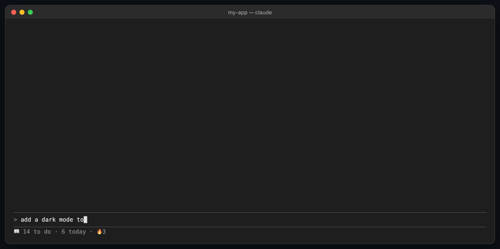
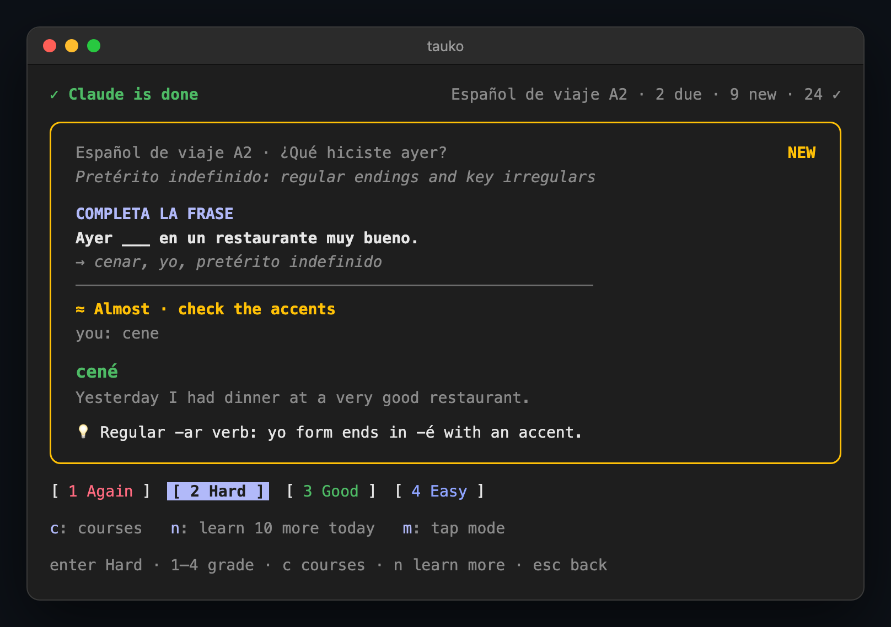
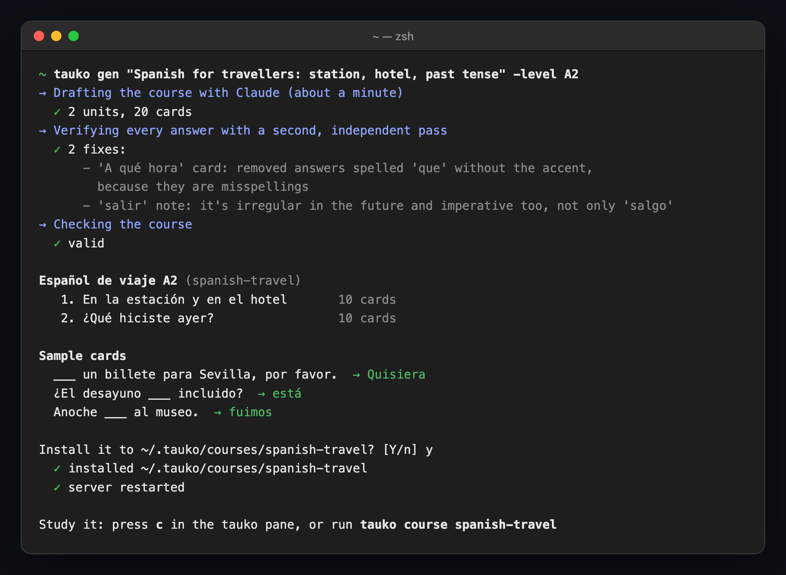
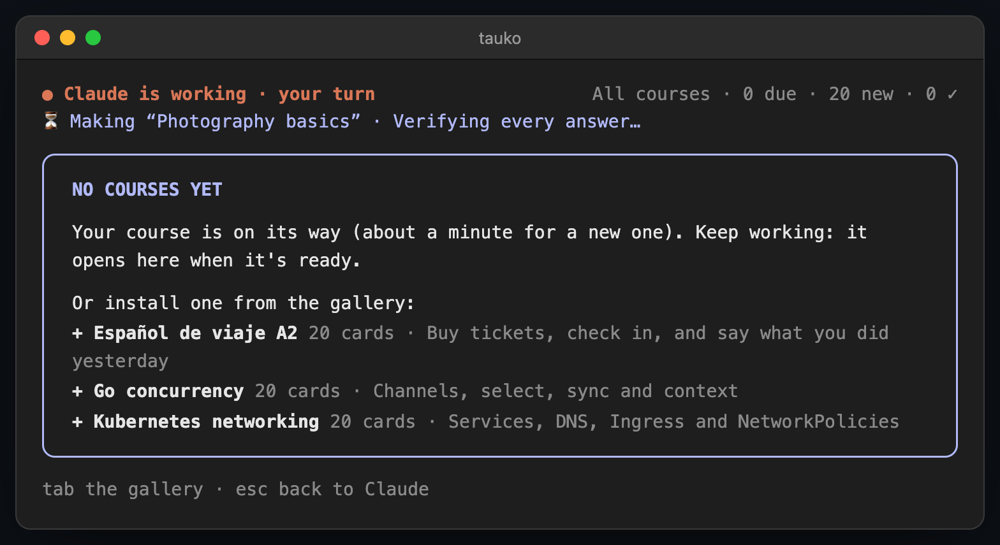
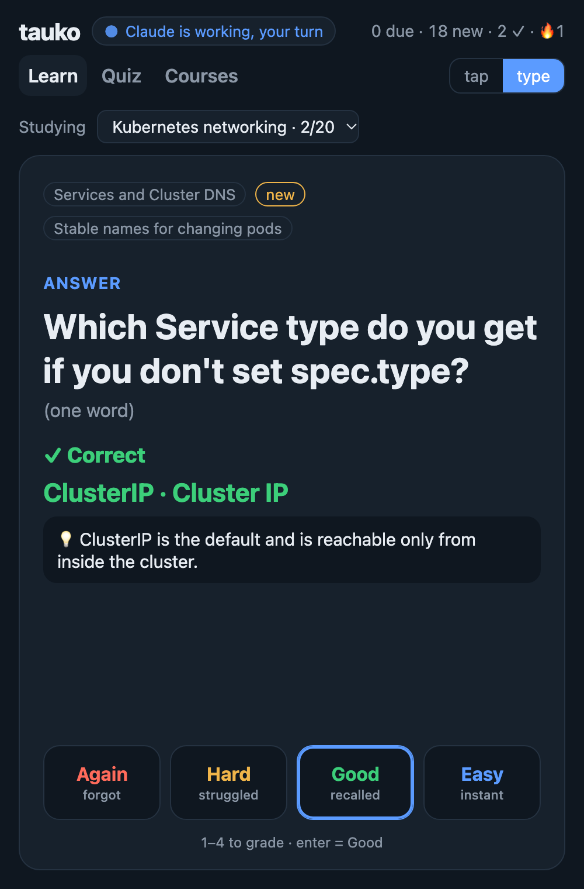

<h1 align="center">tauko</h1>

<p align="center">
  <b>Turn AI wait time into skill.</b><br>
  Flashcards on any subject appear beside Claude Code while it works, and get out of the way when it's done.
</p>

<p align="center">
  <a href="https://github.com/ralihachev/tauko/releases/latest"></a>
  <a href="https://github.com/ralihachev/tauko/actions/workflows/ci.yml"></a>
  <a href="LICENSE"></a>
  
</p>

<p align="center"></p>

You send Claude a prompt and wait: thirty seconds, two minutes, fifty times a day. That's an hour of
dead time, and it usually goes to the phone.

**tauko** puts that time to work. When you press enter, a card opens next to the chat, on whatever
you want to get better at: Spanish, world history, photography, a certification, your team's codebase. Answer it, maybe
another one. When Claude finishes, tauko says so and you're back. Spaced repetition (FSRS) picks the
card you're about to forget, so those half-minutes turn into things you remember.

Need a course? Ask for one: type a topic in the pane, or run `tauko gen "Spanish for travellers"`.
Claude writes it, a second pass checks every answer, and tauko installs it.

## Quick start

```sh
curl -fsSL https://raw.githubusercontent.com/ralihachev/tauko/main/install.sh | sh
```

Then get something to learn. Start Claude Code, send any prompt, and the pane offers the gallery and a
"make one about anything" field. Or, from a terminal:

```sh
tauko gen "Italian for beginners" -level A1   # generate a course about anything
tauko add                                     # or browse the gallery
tauko add spanish-a2-travel                   #   and install one
```

Start Claude Code with `tauko claude` and send any prompt. That's all. (Plain `claude` works too, without
the pane docked beside the chat.)

The installer downloads a single ~5 MB binary for your OS and CPU, verifies its checksum, puts it in
`~/.local/bin` (no sudo), starts a small local server and installs the Claude Code plugin. Nothing is
sent anywhere: no account, no telemetry. `tauko doctor` checks the setup at any time.

<details>
<summary>Other ways to install</summary>

```sh
go install github.com/ralihachev/tauko/cmd/tauko@latest && tauko setup   # Go 1.26+

git clone https://github.com/ralihachev/tauko && cd tauko && make install && tauko setup
```
</details>

## How it works

```
 you press enter ──▶ Claude starts working ──▶ a card opens beside the chat
                                                 │
                       answer · grade · next  ◀──┘   (as many as you like)
                                                 │
 back to Claude  ◀── "✓ Claude is done"  ◀───────┘
```

- **The card comes to you.** There's no app to open and nothing to remember: the wait itself is the trigger.
- **Learn, then check.** New to a topic? A short lesson (under 40 seconds) introduces each idea, then a quick question checks it, then spaced cards keep it.
- **Recall, not reading.** You type the answer (or recall it and reveal). A typo or a missing accent counts as "almost", not wrong.
- **Ask why.** After any card, press `e` and Claude explains *your* answer: "cene without the accent is the subjunctive; past tense needs cené".
- **One card is 5 to 20 seconds.** Leave mid-card when Claude is done; nothing is lost.
- **The schedule adapts.** Grade each card Again, Hard, Good or Easy, and FSRS spaces its next review: minutes for new cards, weeks for well-known ones.
- **It never runs dry.** tauko introduces 20 unseen cards a day so your reviews stay manageable. Once you've done today's cards, it switches to **practice**: the cards you're closest to forgetting, all day long. Press `n` to learn 10 more unseen cards instead.

Answer, see what you missed, grade it, next:

<p align="center"></p>

## What the cards look like

A course mixes five kinds of cards:

| Kind | Example prompt | You answer |
|---|---|---|
| **recognize** | el andén | platform |
| **produce** | return ticket | el billete de ida y vuelta |
| **fill in** | Ayer ___ en un restaurante muy bueno. *(cenar, yo, past)* | cené |
| **rewrite** | Make it polite: *Quiero una habitación individual.* | Quisiera una habitación individual. |
| **question** | In which year did the Berlin Wall fall? | 1989 |
| **lesson** | *A 40–80 word explanation of one idea, read once before its cards* | (nothing to answer: "got it") |

Open questions with no single right answer ("Why did the Berlin Wall fall?") are
**self-graded**: you write your answer, see a model answer next to it, and grade yourself.

## Get courses

### Generate one with Claude

```sh
tauko gen "Spanish for travellers" -level A2
tauko gen "World history: the Cold War" -units 4
tauko gen "my driving theory notes" -from notes.pdf     # text, markdown or PDF
```

`tauko gen` uses Claude Code (`claude -p`, on your existing plan) in three steps:
1. **Draft:** Claude writes the course: short lessons for each idea, then the cards that check them.
2. **Verify:** a second, independent pass checks every answer and fixes wrong or ambiguous cards.
3. **Check and preview:** tauko runs its own course checks and shows you the result.

On confirm, it installs the course and reloads the server. A 2-unit course takes about a minute.
From the pane (`c`, then `a`), the same happens in the background while you keep working, and the
course opens in the pane when it's ready:

<p align="center"></p>

Or make one without leaving Claude Code: press `c`, then `a`, and type a topic. With no courses
installed, the pane opens on this screen by itself:

<p align="center"></p>

Generated courses are a draft, not a textbook. If a card looks wrong, edit it in `~/.tauko/courses/`
and run `tauko restart`.

### Install one from the gallery

```sh
tauko add                          # list the gallery
tauko add spanish-a2-travel        # install a course
```

| Course | Cards |
|---|---|
| [Español de viaje A2](examples/courses/spanish-a2-travel): tickets, hotels, and saying what you did yesterday | 20 |
| [Go concurrency](examples/courses/go-concurrency): channels, select, sync, context | 20 |
| [Kubernetes networking](examples/courses/kubernetes-networking): Services, DNS, Ingress, NetworkPolicies | 20 |

Made a good one? Add it to `examples/courses` and open a pull request.

### Write your own

A course is a folder with two kinds of JSON file. Make `~/.tauko/courses/photo/course.json`:

```json
{ "id": "photo", "title": "Photography basics" }
```

…and `~/.tauko/courses/photo/decks/01-exposure.json`:

```json
{
  "id": "photo-01",
  "title": "Exposure",
  "drills": [
    { "id": "photo-01-q1", "type": "qa", "prompt": "Which setting mostly decides how much of the photo is in focus?",
      "answers": ["aperture", "the aperture", "f-stop"] },
    { "id": "photo-01-q2", "type": "cloze", "prompt": "A fast shutter speed ___ motion.",
      "hint": "freezes or blurs?", "answers": ["freezes"] }
  ]
}
```

Then run `tauko restart`. The full format (vocabulary pairs, notes, examples, special-character
keys for languages) is in **[docs/COURSES.md](docs/COURSES.md)**.

## Everywhere you wait

**In Claude Code** (installed by the quick start):

| Key | Does |
|---|---|
| type + `enter` | check your answer |
| `enter` or `1`–`4` | grade it and move on |
| `c` | switch course, or study all of them (new cards rotate); `a` there adds a course |
| `n` | learn 10 more unseen cards today |
| `e` | explain this card: why the answer is what it is, for what you typed |
| `k` | I know this: retire the card so it never comes back (undo right after, or `tauko restore`) |
| `m` | switch between typing and tap-to-reveal |
| `Esc` / `ctrl+x tab` | back to the prompt / back to the card |
| `/tauko` | open the pane by hand |

`c`, `n`, `e`, `k` and `m` work once you've answered. While you type, every letter goes into your answer; Tab
reaches the same buttons. In Claude Code's fullscreen mode, the pane docks beside the chat: `tauko claude`
starts it that way (it's `claude` with `CLAUDE_CODE_NO_FLICKER=1`, and takes the same flags), or turn it on in `/config`.
The status line shows what's left: `📖 14 to do · 6 today · 🔥3`.

**In the terminal:**

```sh
tauko                          # learn (type mode)
tauko learn -mode tap          # recall, then reveal
tauko course                   # list courses; tauko course photo to switch
tauko quiz -course photo       # 10 questions, scored
tauko stats                    # today, streak, totals
```



**In the browser:** http://127.0.0.1:8787 shows the same cards with a course picker and the
"Claude is working" / "Claude is done" banner.

**On your phone:** let the server listen beyond your machine, with a token:

```sh
TAUKO_TOKEN=$(openssl rand -hex 16) tauko serve -addr 0.0.0.0:8787
```

Open `http://<your-computer>:8787/?token=<token>` (over [Tailscale](https://tailscale.com), for example) and
**Add to Home Screen**. Put it where Instagram used to be.

<br clear="right">

## FAQ

**Does it slow Claude down?**
Not noticeably. When you press enter, the plugin makes one call to the local server, which takes milliseconds. If the server is down, the pane says so and Claude carries on.

**Where is my data?**
Your progress is in `~/.tauko/tauko.db` (SQLite) and your courses are in `~/.tauko/courses/`, both on
your machine. tauko only goes online for `tauko add` and `tauko gen` (via Claude Code).

**Can I use it without Claude Code?**
Yes: the terminal and browser work on their own. `tauko gen` needs Claude Code; writing courses by hand and `tauko add` don't.

**Does it work for languages?**
Yes. Any language works: answers are checked with tolerance for missing accents (é, ñ, ü, ø, …), and a
course can add on-screen keys for special characters.

**How is this different from Anki or Duolingo?**
Same science (spaced repetition), different trigger. Those apps need you to decide to study. tauko uses
the waits you already have, so it doesn't compete for your evening, and it makes a course about anything in a minute.

**Windows?**
Not yet natively. It works in WSL.

**Something's off.**
Run `tauko doctor`: it checks the binary, server, plugin and your courses, and says how to fix each. The server log is `~/.tauko/serve.log`.

## Commands

| Command | Does |
|---|---|
| `tauko gen "topic"` | generate a course with Claude, verify it, install it (`-level`, `-units`, `-from file`, `-dry-run`) |
| `tauko add [id\|folder]` | list the course gallery, or install a course from it or from a folder |
| `tauko course [id\|all]` | show courses, or switch the one every client studies |
| `tauko learn` / `quiz` / `units` / `stats` | study and track progress in the terminal |
| `tauko more [n]` | learn n more unseen cards today (default 10) |
| `tauko retired` / `tauko restore <id>` | list cards you marked "I know this", bring one back |
| `tauko claude` | start Claude Code in fullscreen so the pane docks beside the chat; flags pass through (`tauko claude --continue`) |
| `tauko setup` | install the Claude Code plugin and start the server (safe to re-run; also upgrades) |
| `tauko doctor` | check everything and say how to fix it |
| `tauko restart` | restart the server after editing a course |
| `tauko uninstall` | remove the plugin and stop the server; `-purge` also deletes your progress |

## Roadmap

- **Diff quizzes:** questions about the code Claude just changed, to keep your own skills sharp.
- **Generate from the pane:** `/tauko gen "topic"` without leaving Claude Code.
- **Imports** from Anki and CSV.
- **More places to wait:** Cursor/VS Code, build and CI waits (`tauko run make test`).
- **Teams:** shared courses and small weekly leagues.

The thinking behind it is in [docs/DESIGN.md](docs/DESIGN.md).

## Contributing

Courses, bug reports and code are all welcome. See [CONTRIBUTING.md](CONTRIBUTING.md). If tauko helps
you, a ⭐ helps others find it, and you can [buy me a coffee ☕](https://ko-fi.com/romanslab).

*tauko* is Finnish for "a pause".

## License

Code: [Apache-2.0](LICENSE). Gallery courses: [CC BY-SA 4.0](examples/LICENSE).
